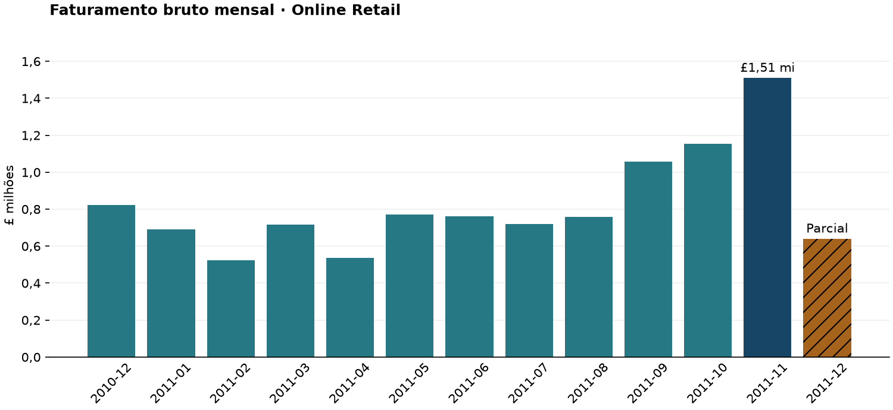

# Análise de varejo com Python e SQLite

O projeto importa vendas para um banco SQLite local. Uma consulta SQL calcula o número de pedidos e o faturamento bruto de vendas por mês, em libras esterlinas.

## Rodar com dados fictícios

```bash
python3 analise.py dados/amostra.csv --banco amostra.sqlite3
python3 relatorio.py --mes 2011-01 --banco amostra.sqlite3
```

O exemplo cria um banco separado em `amostra.sqlite3`. A amostra tem cinco linhas e gera £13.50 em janeiro e £12.00 em fevereiro. O banco guarda todas as linhas. A consulta exclui cancelamentos, quantidades não positivas e preços não positivos para calcular o faturamento bruto. Uma importação válida substitui a tabela `vendas` em uma transação. Se o arquivo não tiver vendas ou contiver uma linha inválida, o banco anterior é preservado.

## Importar as vendas reais

Baixe a base [Online Retail da UCI](https://archive.ics.uci.edu/dataset/352/online+retail), extraia a planilha e salve `Online Retail.xlsx` na pasta `dados`. Depois execute os comandos abaixo em um ambiente Python com `pip`.

```bash
python3 -m venv .venv
source .venv/bin/activate
python -m pip install -r requirements.txt
python analise.py "dados/Online Retail.xlsx"
```

A base tem 541.909 linhas de itens de pedidos de uma loja virtual do Reino Unido, de dezembro de 2010 a dezembro de 2011. Dezembro de 2011 é parcial. Os preços são armazenados como números inteiros em unidades de £0,0001 para preservar a precisão no SQL.

Fonte dos dados reais: Daqing Chen, *Online Retail* (2015), UCI Machine Learning Repository, [DOI 10.24432/C5BW33](https://doi.org/10.24432/C5BW33), licença [CC BY 4.0](https://creativecommons.org/licenses/by/4.0/).

## Relatório mensal para a diretoria

Depois de importar a planilha, escolha um mês para gerar um relatório sob demanda:

```bash
python3 relatorio.py --mes 2011-11
```

O relatório aparece no terminal e o rascunho fica em `relatorios/email-AAAA-MM.txt`. Para o fluxo agendado, configure o agendador do computador para executar `python3 relatorio.py` no dia 10 de cada mês. Sem opções, o script verifica o dia e consulta o mês anterior. Use `--data 2011-12-10` para simular uma execução desse fluxo.

### Exemplo com os dados reais

```text
Assunto: Resultado de vendas de 2011-11

Faturamento bruto: £1.509.496,33
Pedidos: 2769
Ticket médio: £545,14
Variação do faturamento frente a 2011-10: +30,7%

Produto com mais unidades: RABBIT NIGHT LIGHT (23084), 14.954 unidades
País com maior faturamento: United Kingdom, £1.325.346,21
```



- Novembro de 2011 teve o maior faturamento bruto observado, **£1,51 milhão**, com alta de **30,7%** frente a outubro.
- O Reino Unido respondeu por cerca de **88%** do faturamento de novembro, mostrando a concentração das vendas naquele mercado.

### Como os indicadores são calculados

O faturamento bruto soma quantidade × preço das vendas válidas. A regra de validade está em `vendas_validas.sql` e é usada pelo resumo mensal e pelo relatório. No cliente SQLite, execute esse arquivo na mesma conexão antes de executar `consultas.sql`.

Pedidos são faturas distintas com pelo menos uma venda válida. O ticket médio divide o faturamento bruto pelo número de pedidos. A variação mensal é exibida quando ambos os meses estão dentro do intervalo de datas observado na base e o mês anterior tem faturamento positivo. Esse intervalo não garante que não haja lacunas dentro dele. Dezembro de 2011 tem dados só até o dia 9.

O relatório traz os cinco primeiros produtos por unidades e países por faturamento, além dos extremos. Empates nos extremos são contabilizados, com até cinco nomes exibidos em cada extremo. Quando um código tem múltiplas descrições no mês, o relatório exibe a primeira descrição não vazia em ordem lexicográfica. A base histórica não fornece vendedor ou estado.

## Testes

```bash
python3 -m unittest discover -s tests -v
```

Os testes usam arquivos temporários e não dependem da planilha oficial. O GitHub Actions executa a mesma suíte em pushes e pull requests.
